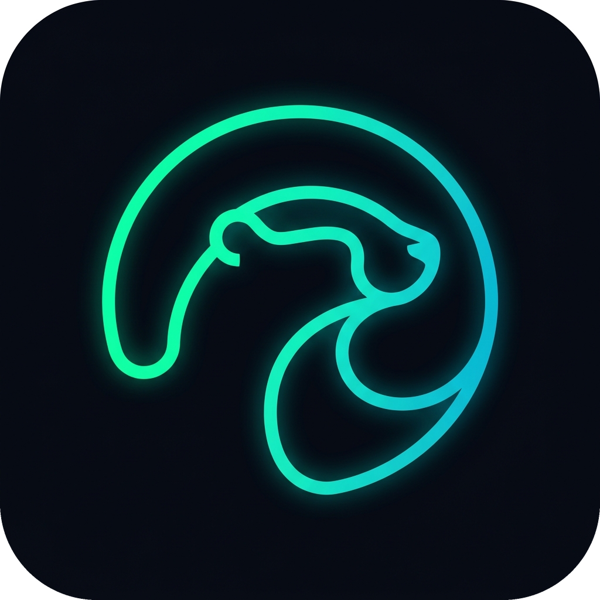

<p align="center">
  
</p>

<h1 align="center">OpenNotch</h1>

<p align="center">
  <b>A sleek, fluid, and dynamic notch overlay for Linux desktops.</b>
</p>

<p align="center">
  <a href="https://github.com/gagan-gv/open-notch/releases"></a>
  <a href="https://www.rust-lang.org/"></a>
  <a href="https://gtk-rs.org/"></a>
  <a href="LICENSE"></a>
  
</p>

---

## Overview

**OpenNotch** is an interactive desktop notch and floating shelf built natively for Linux. Anchored to the top-center edge of your screen, OpenNotch rests discreetly as a compact status pill and smoothly expands on hover into a multi-purpose productivity shelf.

Meet **Otty the River Otter**, the OpenNotch mascot! Like an otter that keeps its favorite tools and pebbles safe in its pocket, OpenNotch keeps your media controls, clipboard clippings, files, notes, and productivity timers right at your fingertips.

---

## Key Features

* **🔄 In-App GitHub Update Checker (New in v0.2.0)**: Background release detection queries GitHub's API to notify you the moment a new version drops, with one-click release notes and `.deb` downloads.
* **⚙️ In-Shelf Preferences & Autostart (New in v0.2.0)**: Native settings tab to toggle "Start at Login" and manage preferences without focus-loss popups.
* **🦦 Mascot Branding & Icon Suite (New in v0.2.0)**: Featuring "Otty" in a Cyber-Mint palette with full FreeDesktop standard vector and multi-resolution icons (`32×32` to `512×512`).
* **📂 Drop Shelf (File Transit Tray)**: Temporary holding area to drag, stage, and drop files and images across workspaces and applications.
* **📋 Clipboard History**: Lightweight clipboard manager preserving recent text snippets for rapid re-copying.
* **🎵 Universal MPRIS Media Controller**: Real-time track information, album art, interactive scrubber, and playback controls for Spotify, browsers, and local players via D-Bus.
* **📅 Glanceable Calendar**: Dynamic date strip and month view displayed automatically when no media is actively playing.
* **⏱️ Focus / Pomodoro Timer**: Customizable interval countdown with work and break sessions.
* **📝 Quick Scratchpad**: Clean text scratchpad for rapid thoughts, drafting, or temporary notes.
* **🔋 Battery & Status Hub**: Top-bar glance displaying live battery percentage and charging state with adaptive symbolic icons.
* **✨ Fluid Animations & Glass Aesthetics**: Native GTK4 CSS styling with smooth spring-like easing and glassmorphic transparency.

---

## Interaction Model

```
   [ Resting State (Top-Center Pill) ]
                 │
           (Cursor Enters)
                 ▼
   ┌─────────────────────────────────────────────────────────┐
   │                    [ Expanded Shelf ]                   │
   │                                                         │
   │  [ Nav: Dashboard | Drops | Clip | Focus | Notes | ⚙ ]  │
   │  [ Active Mode: Media Player / Calendar Overview ]      │
   │  [ In-Shelf Preferences: Start at Login | Updates ]     │
   └─────────────────────────────────────────────────────────┘
                 │
           (Cursor Leaves)
                 ▼
   [ Returns to Resting Pill ]
```

---

## Installation

### Option 1: Install Pre-Built `.deb` (Debian, Ubuntu, Zorin OS, Linux Mint)

Download the latest `.deb` package from the [Releases](https://github.com/gagan-gv/open-notch/releases) page:

```bash
# Download v0.2.0 .deb package
wget https://github.com/gagan-gv/open-notch/releases/download/v0.2.0/open-notch_0.2.0_amd64.deb

# Install package
sudo apt install ./open-notch_0.2.0_amd64.deb
```

Once installed, OpenNotch will be available in your system application menu and can be set to autostart on login.

---

### Option 2: Build & Install from Source

#### 1. Install Build Dependencies

```bash
# Ubuntu / Debian / Zorin OS / Linux Mint
sudo apt update && sudo apt install -y build-essential libgtk-4-dev pkg-config git curl

# Arch Linux / Manjaro
sudo pacman -S base-devel gtk4 git curl

# Fedora
sudo dnf install -y gcc gtk4-devel pkgconf-pkg-config git curl
```

#### 2. Install Rust (if not already installed)

```bash
curl --proto '=https' --tlsv1.2 -sSf https://sh.rustup.rs | sh
source "$HOME/.cargo/env"
```

#### 3. Clone & Install

```bash
git clone https://github.com/gagan-gv/open-notch.git
cd open-notch

# Build and install for current user (no sudo required):
make install-user

# Or install system-wide:
sudo make install
```

To run immediately:
```bash
open-notch
```

---

## Autostart & Background Service

* **Via UI**: Click the **⚙ Settings** icon in the shelf and toggle **"Start at Login"**.
* **Via Systemd (User Service)**:
  ```bash
  systemctl --user enable --now open-notch.service
  ```

---

## Window Layering & Compatibility

OpenNotch supports both modern Wayland compositors and standard X11 window managers:

| Protocol | Backend & Hints | Supported Environments |
| :--- | :--- | :--- |
| **X11 / XWayland** | `_NET_WM_WINDOW_TYPE_DOCK`, `_NET_WM_STATE_ABOVE` | GNOME (X11 & XWayland default), XFCE, i3, bspwm, KWin |
| **Wayland Native** | `gtk4-layer-shell` (`top` / `overlay` layer) | Hyprland, Sway, River, Wayfire |

> **Note**: For native layer-shell Wayland compositors (Hyprland, Sway), build with the `layer-shell` cargo feature:
> ```bash
> cargo build --release --features layer-shell
> ```

---

## Configuration

Configuration is stored in `~/.config/open-notch/config.toml` and updates dynamically:

```toml
[notch]
monitor = "primary"
collapsed_width = 180
collapsed_height = 30
expanded_width = 520
expanded_height = 210
animation_duration_ms = 200
leave_debounce_ms = 250

[behavior]
default_idle_view = "calendar"
mpris_auto_expand = false

[pomodoro]
focus_duration = 25
break_duration = 5
sound_alerts = true
```

---

## Contributing

Contributions, bug reports, and feature requests are welcome!

1. Fork the repository on GitHub.
2. Create a feature branch (`git checkout -b feature/my-feature`).
3. Commit your changes (`git commit -m 'feat: add amazing feature'`).
4. Push to the branch (`git push origin feature/my-feature`).
5. Open a Pull Request.

---

## License

Distributed under the **MIT License**. See [LICENSE](LICENSE) for details.
